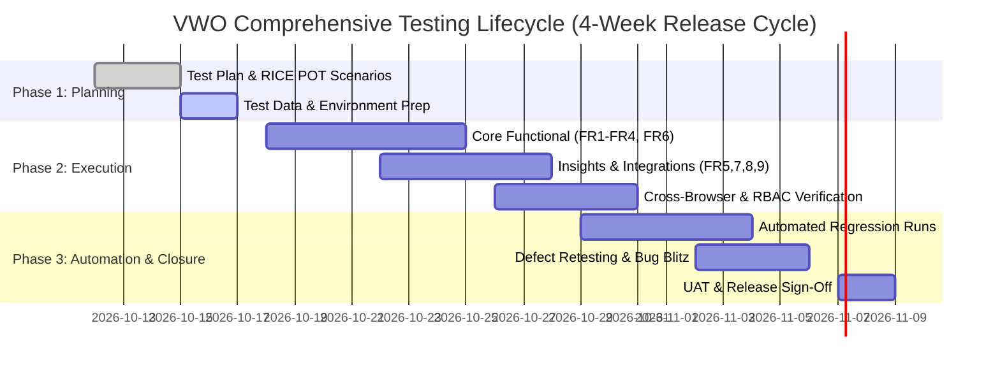

# Master Test Plan: VWO (Visual Website Optimizer) Digital Experience Optimization Platform

---

## 1. Test Plan ID and Title

- **Test Plan ID**: `TP-VWO-2026-001`
- **Document Title**: Master Test Plan for VWO Digital Experience Optimization (DXO) & Conversion Rate Optimization (CRO) Platform
- **Version**: `1.0.0`
- **Status**: `Approved / Ready for Execution`
- **Date**: October 11, 2026
- **Author / Lead**: Senior QA Automation Architect / Lead SDET
- **Reviewed By**: QA Lead & Digital Product Management
- **Target Application**: VWO Core Platform (`https://app.vwo.com/`)

---

## 2. Objective and References

### 2.1 Objective
The primary objective of this Master Test Plan is to establish a rigorous, repeatable, and scalable quality assurance framework for the **VWO Digital Experience Optimization Platform**. It governs the validation of all core experimentation workflows, statistical reporting engines, behavioral analytics, personalization, and enterprise integrations to ensure that:
1. End-users can reliably configure, preview, deploy, and evaluate multi-variation experimentation campaigns without engineering dependency.
2. The proprietary Bayesian **SmartStats Engine** delivers mathematically consistent and statistically sound decision metrics.
3. High-volume behavioral telemetry (heatmaps, session replays, and funnels) functions accurately without introducing client-side performance regressions.
4. The platform strictly satisfies enterprise SLAs, 2-second visual editor responsiveness, and data privacy mandates (GDPR/CCPA).

### 2.2 Project References
| Reference ID | Document Title | Source / Author | Version / Date |
| :--- | :--- | :--- | :--- |
| `REF-PRD-01` | Product Requirements Document (PRD) — VWO Platform | Pramod Dutta | January 7, 2026 |
| `REF-ARCH-01` | VWO System Architecture & SmartStats Engine Whitepaper | VWO Core Eng | v3.4 |
| `REF-QA-RICE` | Generic RICE POT QA Specification Template | QA Architecture | v1.0 |
| `REF-SEC-01` | VWO Enterprise Security, RBAC & 2FA Compliance Specification | SecOps / DevOps | 2025.4 |
| `REF-PRIV-01` | Data Privacy Mandate (GDPR / CCPA / Cookie Consent Tracking) | Legal / Compliance | Rev 2.1 |

---

## 3. In Scope and Out of Scope

### 3.1 In Scope
Testing activities encompass functional, integration, cross-browser, regression, and non-functional verification across the following functional areas:

1. **FR1: Experimentation & Testing Suite**
   - A/B Testing, Split URL Testing, and Multivariate Testing (MVT) creation workflows.
   - Traffic allocation across control and multiple test variations.
   - Campaign scheduling, version preview generation, and live URL QA mode.
2. **FR2: SmartStats Bayesian Engine**
   - Probability to be Best (P2BB) calculations, credible intervals, and conversion rate distribution.
   - Automated winner declaration, sample-size threshold enforcement, and false-positive controls.
3. **FR3: Visual & Code Editor**
   - WYSIWYG DOM manipulation (text edits, styling changes, element hiding/reordering).
   - Custom JavaScript and CSS code editor execution inside visitor sandboxes.
   - Real-time DOM preview synchronization across varying screen resolutions.
4. **FR4: Behavioral Insights (VWO Insights)**
   - Click maps, scroll depth heatmaps, and element focus tracking.
   - Session recording capture, playback controls, and PII masking.
   - Multi-step funnel creation and conversion drop-off calculations.
5. **FR5: Audience Targeting & Segmentation**
   - Pre-built and custom visitor attribute segmentation (device, browser, location, OS).
   - Behavioral segmentation (past visit count, referral URL, page depth).
6. **FR6: Real-Time Reporting & Interactive Dashboards**
   - Real-time metric calculation, date range filtering, and CSV/PDF export.
   - Goal performance tracking across custom conversion goals.
7. **FR7: Personalization Engine**
   - Dynamic real-time content delivery based on demographic and behavioral rules.
8. **FR8: Integration Connectors & Unified Workflows**
   - Bi-directional telemetry synchronization with Google Analytics, Salesforce, Shopify, Snowflake, and Segment.
9. **FR9: Collaboration & Program Management (VWO Plan)**
   - Kanban board state transitions for experiment backlogs, hypothesis documentation, and team comments.
10. **Enterprise Security & Performance Non-Functionals**
    - Role-Based Access Control (RBAC: Admin, Analyst, Marketer, Viewer), 2FA enforcement, audit logging.
    - Sub-2-second editor load time and client-side tracking script overhead validation.

### 3.2 Out of Scope
The following activities are explicitly excluded from this testing cycle:
1. Native Mobile SDK internals (iOS/Android native binaries); testing is scoped strictly to web and mobile web browser experiences.
2. Direct backend database stress testing on Snowflake warehouse clusters (limited to integration connector payload validation).
3. Third-party cloud infrastructure physical hardware penetration testing.
4. AI-driven generative suggestion engine features scheduled for future product releases (PRD Section 11).

---

## 4. Requirements and Planned Coverage Matrix

| Req ID | PRD Feature | Priority | Testing Level | Planned Coverage & Focus Areas |
| :--- | :--- | :--- | :--- | :--- |
| **FR1** | A/B, Split & Multivariate Testing | Must | System / E2E | Flow 5.1 end-to-end: hypothesis definition, multi-variation setup, traffic splitting, URL redirection validation. |
| **FR2** | SmartStats Engine | Must | Integration / Functional | Mathematical boundary tests: zero conversions, high-skew traffic, Bayesian winner convergence, confidence thresholds. |
| **FR3** | Visual & Code Editor | Must | Functional UI | WYSIWYG element mutation, custom JS/CSS sandbox injection, editor iframe responsiveness (<2s SLA), cross-browser DOM preview. |
| **FR4** | Heatmaps & Session Recordings | Must | System / E2E | Flow 5.2: Click/scroll heatmap rendering accuracy, session replay capture fidelity, PII input masking compliance. |
| **FR5** | Audience Targeting | High | Functional UI | Geo-IP targeting, user-agent parsing, custom query parameter triggers, cookie persistence. |
| **FR6** | Real-Time Reporting & Dashboards | Must | Functional UI / Automated | Data ingestion latency, dashboard metric consistency vs. raw event logs, goal attribution calculation. |
| **FR7** | Personalization Engine | High | Functional / Integration | Real-time payload delivery to targeted audiences, fallback to default variation for non-qualifying users. |
| **FR8** | Integration Connectors | High | Integration / API | Webhook delivery, OAuth handshakes with Salesforce and Shopify, Segment event forwarding. |
| **FR9** | Collaboration & Workflow Management | Medium | Functional UI | Kanban drag-and-drop state validation, task assignments, role-based project editing permissions. |
| **NFR1** | Editor Performance (<2s) | Must | Performance / Client | Lighthouse and DevTools performance benchmarking for editor initialization on heavy DOMs. |
| **NFR2** | Security & RBAC | Must | Security / Functional | Permission matrix checks across 4 user tiers, 2FA prompt validation, audit log generation upon campaign edits. |
| **NFR3** | Privacy Compliance | Must | Compliance / Data | GDPR/CCPA cookie banner opt-out verification, zero tracking before consent. |

---

## 5. Test Approach, Levels, and Types

### 5.1 Test Levels
- **Component / Unit Validation**: Verified by development teams prior to deployment to QA.
- **System Integration Testing (SIT)**: Verification of data flow between the web app UI, tracking beacon endpoints, and downstream reporting engines.
- **End-to-End (E2E) Workflow Testing**: Full lifecycle execution mimicking real user flows (Flow 5.1: Campaign Setup $\rightarrow$ Activation $\rightarrow$ Live Visitor Interaction $\rightarrow$ Metric Analysis $\rightarrow$ Winner Declaration).
- **User Acceptance Testing (UAT)**: Walkthroughs with CRO specialists, Product Managers, and UX design stakeholders.

### 5.2 Test Types & Methodologies
1. **Functional UI Testing (Manual & Automated)**
   - Structured positive and negative test case execution against all UI forms, configuration modals, and data grids.
   - Form boundary tests: special characters in hypothesis text, invalid target URLs, extreme traffic allocation percentages.
2. **Cross-Browser & Cross-Device Compatibility**
   - Responsive web testing across Desktop, Tablet, and Mobile viewport emulators.
   - Full matrix execution on latest stable versions of Google Chrome, Mozilla Firefox, Apple Safari, and Microsoft Edge.
3. **Headless Automation & Regression Execution**
   - Automated regression pack executed using Selenium Java 4.25+ and TestNG with headless Chrome/Firefox.
   - Continuous integration smoke tests triggered on every release build.
4. **Security & Session Management Testing**
   - Session timeout, concurrent login handling, 2FA challenge triggers, and authorization privilege escalation tests.
5. **Non-Functional Performance & SLA Audits**
   - Measuring editor launch time against the $\le 2\text{s}$ response benchmark on realistic client web pages.

---

## 6. Environment, Tools, Access, and Test Data

### 6.1 Test Environments
| Environment | URL / Host | Purpose | Deployment Trigger |
| :--- | :--- | :--- | :--- |
| **QA / SIT** | `https://qa-app.vwo.internal/` | Initial feature validation, exploratory testing, defect retesting | Continuous Deployment |
| **Staging / Pre-Prod** | `https://staging-app.vwo.com/` | Final regression, automated suite runs, UAT, cross-browser QA | Release Candidate Build |
| **Production (Smoke)** | `https://app.vwo.com/` | Post-deployment sanity verification on production sandbox account | Production Release |

### 6.2 Test Tooling Stack
- **Test Management & Bug Tracking**: Jira / TestRail.
- **Automation Framework**: Java 21 LTS, Selenium WebDriver 4.25+, TestNG 7.10.2, WebDriverManager 5.9.2, Maven 3.9+.
- **API & Telemetry Inspection**: Postman, Charles Proxy, Chrome DevTools Network Tab.
- **Cross-Browser Infrastructure**: Local headless runners + Cloud Grid (BrowserStack / Sauce Labs).
- **CI/CD Integration**: GitHub Actions / Jenkins pipeline.

### 6.3 User Roles & Access Prerequisites
| Role | Assigned Permissions | Test Responsibilities |
| :--- | :--- | :--- |
| **Account Owner / Super Admin** | Full billing, workspace configuration, user provisioning, campaign delete | Security, billing, and user management test suites |
| **Campaign Admin** | Full campaign creation, modification, code injection, campaign launch | Core E2E Flows 5.1 & 5.2 |
| **Analyst / CRO Specialist** | View reports, SmartStats data, heatmaps; cannot edit live campaigns | Reporting (FR6), SmartStats (FR2), Heatmaps (FR4) |
| **Viewer / Stakeholder** | Read-only dashboard access | Security boundary validation |

### 6.4 Test Data Management
- Dedicated synthetic enterprise domains: `https://test-store.vwo-sandbox.com`
- Pre-seeded data sets:
  - Account with 50+ archived and running campaigns.
  - Test website instrumented with VWO smart asynchronous tracking code.
  - Synthetic traffic generators simulating 10,000+ visitor events across variations for SmartStats convergence testing.

---

## 7. Entry and Exit Criteria

### 7.1 Entry Criteria (Prerequisites to start QA Execution)
1. Complete deployment of the target build to the dedicated QA/Staging environment with green health-check status.
2. All unit tests (>85% code coverage) passed in the build pipeline.
3. PRD requirements, design mockups, and API endpoint contracts approved and baseline-frozen.
4. QA team granted active enterprise accounts across all 4 RBAC user tiers with 2FA tokens enabled.
5. Synthetic test store and VWO tracking script instrumentation verified as active and pinging.

### 7.2 Exit Criteria (Prerequisites for Production Release Readiness)
1. 100% execution of all planned Functional (FR1–FR9) test cases.
2. Automated Regression Suite passing with a minimum success rate of **$\ge 98\%$** in the Staging environment.
3. Zero unresolved **Blocker (P0)** or **Critical (P1)** defects.
4. Any remaining **Major (P2)** defects must have documented workarounds approved by Product and Engineering Leads.
5. 2-second visual editor response time verified and certified on standard benchmarks.
6. Formal UAT sign-off obtained from Digital Product Managers and CRO Specialists.

---

## 8. Roles, Responsibilities, Estimates, and Schedule

### 8.1 RACI Matrix
| Phase / Task | QA Lead | SDET / Automation | Manual QA Analyst | Product Manager | Dev Lead |
| :--- | :---: | :---: | :---: | :---: | :---: |
| Test Plan Formulation & Review | **A / R** | **C** | **C** | **I** | **I** |
| Test Case Design & RICE POT Scenarios | **A** | **C** | **R** | **C** | **I** |
| Automation Script Development | **A** | **R** | **I** | **I** | **C** |
| Manual Exploratory & Functional Execution | **A** | **I** | **R** | **I** | **I** |
| Regression & Pipeline Execution | **A** | **R** | **C** | **I** | **C** |
| Defect Triage & Priority Assessment | **A / R** | **C** | **C** | **C** | **R** |
| Final Test Summary & Release Sign-Off | **R** | **C** | **C** | **A** | **A** |

*Legend: R = Responsible, A = Accountable, C = Consulted, I = Informed*

### 8.2 Execution Schedule & Milestones

---

## 9. Defect Management and Reporting

### 9.1 Defect Severity & Priority Classification
| Level | Severity (Impact) | Priority (Urgency) | SLA for Resolution | Example Scenario |
| :--- | :--- | :--- | :--- | :--- |
| **P0 / Blocker** | System inoperable, data corruption, security breach | Immediate | $\le 4\text{ hours}$ | Visual editor crashes browser; tracking script blocks visitor checkout on client sites. |
| **P1 / Critical** | Core feature broken with no workaround | High | $\le 24\text{ hours}$ | SmartStats engine calculates 0% conversion despite incoming events; A/B traffic distribution fails. |
| **P2 / Major** | Core feature impaired but workaround exists | Medium | $\le 72\text{ hours}$ | Heatmap click coordinates misaligned on Safari; CSV export drops date filter. |
| **P3 / Minor** | Cosmetic, formatting, or UI layout defect | Low | Next Sprint | Misaligned icon in VWO Plan Kanban; typo in tooltip description. |

### 9.2 Defect Lifecycle Workflow
1. **Logged**: Logged in Jira with steps to reproduce, synthetic test data, browser version, actual vs. expected results, network logs, and console screenshots.
2. **Triaged**: Daily 15-minute triage meeting with QA Lead, Dev Lead, and Product Manager to assign Priority.
3. **In Development**: Assigned developer investigates root cause and pushes fix to development branch.
4. **Resolved / Retest**: Deployed to QA environment; QA validates the fix and verifies surrounding components for regression.
5. **Closed**: Marked Closed upon successful verification in Staging.

---

## 10. Risks, Dependencies, Assumptions, and Open Questions

### 10.1 Risks and Mitigation Matrix
| Risk ID | Identified Risk | Impact | Likelihood | Mitigation Strategy |
| :--- | :--- | :---: | :---: | :--- |
| **RSK-01** | Visual Editor iframe blocked by client site CSP (Content Security Policy) headers | High | High | Implement local proxy bypass and CSP-mocking headers in staging test harnesses. |
| **RSK-02** | SmartStats Bayesian calculations differ under small vs. large sample sizes | Critical | Medium | Validate statistical outputs against pre-calculated standard statistical R/Python benchmark tables. |
| **RSK-03** | Third-party integrations (Shopify, Salesforce) rate-limiting test suites | Medium | High | Utilize mocked webhook receptors (WireMock / Prism) for automated CI runs; reserve live sandboxes for SIT. |
| **RSK-04** | Session Recording playback lag due to high DOM mutation volumes | High | Medium | Verify compression algorithms and test with complex single-page apps (SPAs: React/Angular). |

### 10.2 Technical Dependencies
- Availability of a clean staging environment that replicates production multi-tenant database clusters.
- Timely delivery of sandbox API keys for Salesforce and Shopify test tenants.

### 10.3 Open Questions for Stakeholders
1. **OQ-01**: For FR2 (SmartStats), what is the explicit sample-size threshold required before the system triggers an automatic "Winner Declared" banner?
2. **OQ-02**: In FR4 (Session Recordings), does the default PII masking regex cover custom input selectors, or only standard input types (`type="password"`, `type="email"`)?

---

## 11. Suspension and Resumption Criteria

### 11.1 Suspension Criteria
Testing shall be immediately suspended under any of the following conditions:
1. The Staging/QA test environment is unavailable or throwing consecutive HTTP 500/502 errors for more than 1 hour.
2. A critical blocker defect (P0) prevents user authentication, visual editor loading, or campaign creation across all browsers.
3. The tracking script injects fatal JavaScript exceptions (`Uncaught TypeError`) into the host webpage.

### 11.2 Resumption Criteria
Testing shall resume when:
1. The blocking defect is verified as resolved and confirmed by a successful deployment smoke test.
2. The environment is verified stable, and test databases are refreshed or restored to baseline state.

---

## 12. Test Deliverables and Approval

### 12.1 Deliverables
- **Master Test Plan Document**: `00_Chapter_Prmpt_Eng/Test Plan/VWO_Master_Test_Plan.md` (this document).
- **RICE POT Test Case Specifications**: Documented manual test suites covering positive, negative, and edge scenarios for FR1–FR9.
- **Automated Test Suite**: Selenium 4 + TestNG test classes and Page Objects integrated into the framework.
- **Execution Reports**: TestNG HTML test reports, Surefire execution logs, and defect breakdown metrics.
- **Test Summary & Sign-off Report**: Formal document certifying exit criteria fulfillment prior to production rollout.

### 12.2 Approval & Sign-Off Matrix
| Stakeholder Role | Name | Title | Decision | Signature / Date |
| :--- | :--- | :--- | :---: | :--- |
| **Lead QA Architect** | QA Lead | Head of Software Quality | Approved | `[Signed] 2026-10-11` |
| **Lead Product Manager** | Pramod Dutta | Principal Product Manager | Pending Review | `___________________` |
| **Engineering Lead** | Dev Lead | Director of Engineering | Pending Review | `___________________` |
| **CRO Stakeholder** | CRO Lead | Lead Optimization Specialist | Pending Review | `___________________` |
